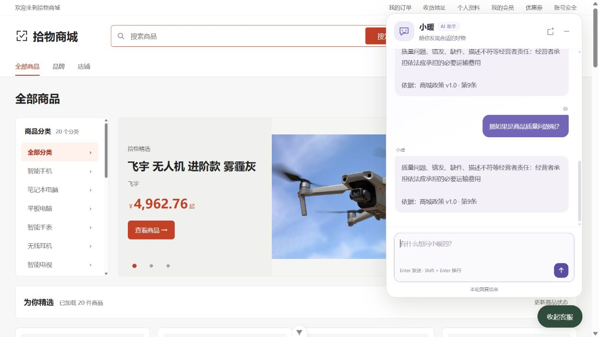

# 电商客服 Agent

基于 FastAPI、LangGraph 和 SSE 的电商客服 Agent。已实现真实商城商品查询、分类筛选、推荐对比与详情跳转，支持多轮条件变更和分页；接入版本化商城政策检索、本人订单与物流查询，以及只读售后引导与进度查询。登录身份与会话归属绑定，支持取消生成、并发接纳控制、模型调用预算和 Token 统计。

客服不代办退款或换货，不把模拟退款状态视为真实到账。真实人工客服闭环未接入，真实账号联调及售后页面四项尚未验收，完整 V1 不代表可上线。商城宿主浮窗位于独立前端项目，本仓库包含 Agent 服务及聊天页面。

2026-11-18 的本地商城与远端模型回归完成三轮 108 条对话（104 条自动断言通过，4 条同义表达误报经语义复核通过），另有 3 组并发取消与恢复均在 5 秒内完成。该结果限于游客与合成测试问题，不代表真实账号或浏览器验收。默认回答、路由、意图模型均为 `qwen3.8-max`，可用性和费用取决于调用方账户。

## 页面演示

以下为 2026-11-15 本地商城联调截图，展示独立商城前端嵌入客服的效果；商城宿主前端不在本仓库。截图保留当时页面与回答，不作为当前版本、真实账号或售后办理验收证明。

### 政策连续追问

用户继续追问商品质量问题，客服回答运输费用承担规则，并给出商城政策版本与条款依据。



### 未实现操作的能力边界

用户要求直接退款时，客服说明当前不能代办，并引导使用商城现有入口或联系销售者。政策问答与实际业务操作分开处理。


## 启动与使用

在项目根目录、配置好本机环境后运行：

```powershell
.\.venv\Scripts\python.exe -m uvicorn agent.http_api:app --host 127.0.0.1 --port 8001 --workers 1
```

打开 http://127.0.0.1:8001/ 。端口可选；最近8000被其他项目占用。当前验证范围单worker、单事件循环。详细配置、模型Key和签名密钥要求见[维护手册](docs/10-操作与维护/维护手册.md)，不要覆盖既有.env或提交密钥。

## 文档与测试

[完整文档导航](docs/README.md) · [用户操作](docs/10-操作与维护/用户操作手册.md) · [当前施工进度](docs/05-施工进度/施工进度.md) · [验收结果](docs/09-验收与交付/验收报告.md)

```powershell
.\.venv\Scripts\python.exe -B -X utf8 -m unittest discover -s tests -p "test_*.py"
node tests/http_ui.test.mjs
```

Python总回归包含Node.js执行的前端用例，需安装Node.js；详细测试条件见[测试计划](docs/08-测试/测试计划.md)。live_开头的测试须显式执行，会涉及真实模型/网络和费用，不能在文档迁移时自动运行。

业务代码在agent，配置、测试、文档分别在根config、tests、docs。旧商品样本文本已移除；政策正文与版本清单位于 agent/rag/policies，商品事实通过商城接口查询。文档入口见[文档导航](docs/README.md)。
